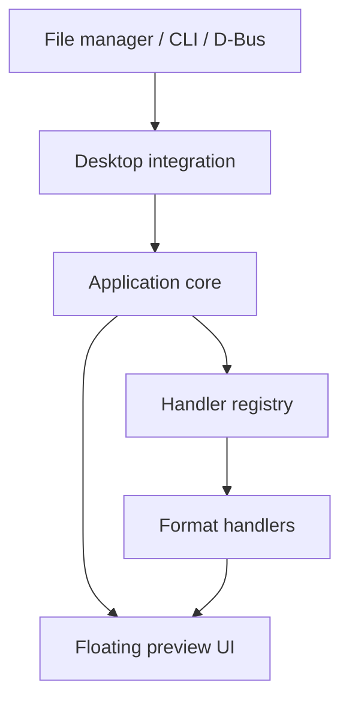

# Peek Architecture

## Implemented: native image, PDF, Markdown, plain-text, video, audio, and ZIP archive previews

The application is C++17 with Qt 6 Widgets. Its current path is deliberately small:

```text
main.cpp: CLI parsing → validatePreviewPath() → PreviewWindow → Qt event loop
```

- `src/main.cpp` handles help/version, no-argument informational startup, one path operand, errors, and application lifetime. `peek PATH` is the common entry point; `peek -- PATH` protects leading-dash operands.
- `src/preview_request.h/.cpp` contain a small request/result and local existence/type validation using Qt Core. Files and directories are accepted, valid symlinks retain their spelling, and other filesystem objects are rejected. There is no content parsing, MIME probing, or directory enumeration.
- `src/preview_window.h/.cpp` implement a concrete decorated widget with plain-text name/path/status labels, an image view, a text view, a Markdown view, a video player, an audio player, and Escape dismissal. Closing the only window ends the application. For files, the window dispatches in order — Poppler PDF first page (when `PEEK_WITH_PDF`), Markdown, plain text, audio (when `PEEK_WITH_MULTIMEDIA`), video (when `PEEK_WITH_MULTIMEDIA`), ZIP archive listing (always built, Qt Core only: central directory only, never extracted), then the `QImageReader` image path — and each handler owns its status message; Escape dismissal and the 1024×768 window cap are shared. Video previews (`src/video_preview.h/.cpp` extension dispatch: mp4, mkv, webm, mov, avi, m4v, case-insensitive) stream through a `QMediaPlayer` + `QVideoWidget` + `QAudioOutput` with Play/Pause, seek slider, and position indicator, starting paused; closing stops playback and clears the source. Audio previews (`src/audio_preview.h/.cpp` extension dispatch: mp3, wav, flac, ogg, opus, m4a, aac, wma, case-insensitive) reuse the same streaming `QMediaPlayer` + `QAudioOutput` backend with an independent player instance and no video output — Play/Pause, seek slider, and duration indicator on a minimal centered label, starting paused; closing stops playback and clears the source. Codec/backend/invalid-file failures stay on the claiming media widget as a status message and never fall through to unrelated previews. Without the Multimedia backend the dispatch still recognizes audio and video extensions and reports them as unsupported. On this development machine the runtime reports bmp, cur, gif, icns, ico, jfif, jp2, jpeg, jpg, mng, pbm, pgm, png, ppm, svg, svgz, tga, tif, tiff, wbmp, webp, xbm, xpm. Images larger than 2048 px on the longest side are downscaled at decode time via the shared bounded decoder in `src/preview_util.h` (used by both the image provider and Markdown image resources): `setScaledSize` when the native size is known, a bounded 2048 px requested size plus a post-decode shrink when it is not (SVG-class formats), so the window never holds a giant pixmap. Markdown images load only from inside the document directory (relative URLs resolve against the document, never the cwd; absolute file: URLs outside it map to a placeholder). Media seek sliders clamp `qint64` durations into the `int` range before casting. The displayed pixmap scales to the image label with `KeepAspectRatio` (fast previews during an interactive resize, one debounced smooth pass ~100 ms after it settles; unchanged sizes skip re-scaling), and the initial window is capped at 1024×768. Directories keep the "Directory preview not implemented yet." placeholder. Unsupported files show "No image preview is available for this file." and undecodable images show "Could not load an image preview of this file (...)." — never a crash. New production dependencies: none mandatory (image I/O comes from Qt Gui via Widgets; Poppler and Qt Multimedia are optional, detected at configure time with `PEEK_WITH_PDF`/`PEEK_WITH_MULTIMEDIA` fallbacks), and no Python is on the preview startup path. This is still not a verified floating/compositor integration.
- Tests link Qt Test only when enabled. The production executable requires only Qt Widgets and its transitive Qt dependencies, plus Poppler C++ when `PEEK_WITH_PDF` is enabled and Qt Multimedia/MultimediaWidgets when `PEEK_WITH_MULTIMEDIA` is enabled.

The optional `integrations/nautilus/peek-nautilus.py` Script is a thin, standalone Python standard-library adapter:

```text
Nautilus Script invocation → NAUTILUS_SCRIPT_SELECTED_URIS → first local URI
                         → decoded absolute path → argv [peek, --, PATH]
                         → existing native CLI / placeholder window
```

It reads selection only at invocation, preserves Nautilus-provided order, decodes percent escapes exactly once as UTF-8, and never constructs a shell command. Python is justified here by safe URI parsing and subprocess argument arrays without shell quoting; it owns no native application logic. Directories and filesystem failures are handled by the native validator. The Script waits until Peek exits so startup/path failures can be reported on stderr and, optionally, through `notify-send`. It is not a daemon or a single-instance controller. Installation and the diagnostic right-click workflow are documented in [nautilus-script.md](nautilus-script.md).

No IPC, background service, settings framework, handler registry, asynchronous handlers, caching, selection caching, polling, clipboard communication, or single-instance behavior is implemented — dispatch is a fixed ordered chain in `PreviewWindow`, not a registry. The only keyboard trigger is user-local configuration (see [quick-look-trigger.md](quick-look-trigger.md)), not shipped code. Native CLI/file handling/image rendering/GUI remain independent of the adapter. Initial validation is not a guarantee of future access; image decoding re-reads the file and surfaces read/decode failures in the window. Accepted race (documented decision, low urgency for a local single-user tool): validation checks existence/type and providers reopen the same path, so the object can change between check and open; the text size race is closed by a bounded `read(limit + 1)`, the remaining type race is accepted rather than threading an open fd through the provider contract.

## Planned direction (not implemented)

The goal is a fast, lightweight, read-only Quick Look-style preview, triggered with Space and dismissed with Escape. The following design is future intent, not a requirement to scaffold abstractions now. Wayland positioning, focus, and shortcut behavior require real desktop testing.



Dependencies point downward. Handlers and integrations know about the core's interfaces. The core knows nothing about specific formats or file managers.

## 1. Application core

Responsible for:

- Application lifecycle, single-instance behaviour (a second invocation re-targets the running instance), and command-line parsing.
- Resolving a requested path into a file description: existence, size, MIME type (via `QMimeDatabase`).
- Asking the handler registry for a handler and passing the result to the UI.
- Settings and logging.

Qt Core only, plus Widgets for the application object. Contains no format-specific code and no file-manager-specific code.

## 2. Floating preview UI

Responsible for:

- A frameless, floating, dismissible window (Escape or the trigger key closes it), sized to the content.
- Hosting a widget supplied by a handler, plus loading, error and "no preview available" states.
- Window behaviour on Wayland/Hyprland, which cannot position or focus arbitrary windows the way X11 can. Behaviour that needs compositor cooperation (floating rules, layer-shell) must be documented and kept in this layer.

The UI never parses file content.

## 3. Modular file-format handlers

Each handler turns a file into something displayable. Planned contract:

- `canHandle(mime type / file info)`, returning a score so the best handler wins.
- `createPreview(file) -> QWidget*` (or an async result), which must not block the UI thread for slow loads.
- Declared capabilities and optional dependencies.

Candidate handlers, in rough priority order: plain text/source code (implemented for 22 known extensions), images (implemented), Markdown (implemented for `md`/`markdown` via Qt's built-in Markdown support, no new dependencies), PDF (implemented, first page only via Poppler), audio/video (implemented via Qt Multimedia), archives (ZIP listing implemented with Qt Core only, no new dependencies; TAR/7z/RAR explicitly out of scope), directories (placeholder). A handler may be compiled out or disabled when its optional dependency is absent. A failing handler must degrade to a generic fallback (file name, size, type) and never crash the application.

## 4. Desktop and file-manager integrations

Thin adapters that translate an external trigger into "preview this path":

- Command line: `peek <path>`.
- Implemented: initial Nautilus selection handoff through a thin Script calling `peek -- PATH`; the right-click workflow is a diagnostic fallback, not the final UX. Python is limited to the standard-library adapter and its tests.
- The Hyprland shortcut forwarding a dedicated Nautilus Script accelerator ([quick-look-trigger.md](quick-look-trigger.md)): lab-verified end to end with synthetic keys; one physical-keypress acceptance on the live desktop is still pending. Space behavior stays unbound by design (global Space would break typing; Omarchy reserves the modified-Space chords).
- Optional native D-Bus integration only if an approved later task justifies it; no cached-selection bridge, polling, clipboard tricks, or background daemon.
- Desktop entry and MIME associations.

Each integration lives in its own module and can be built or omitted independently. The core must work with only the command line.

## 5. Optional dependencies

The base build requires only Qt 6 Widgets. Everything else is optional and detected at configure time, with a CMake option per feature, for example:

| Feature | Actual dependency |
| --- | --- |
| PDF | Poppler C++ (`poppler-cpp` via pkg-config), switch `PEEK_WITH_PDF` |
| Audio/video | Qt Multimedia + MultimediaWidgets (FFmpeg backend at runtime), switch `PEEK_WITH_MULTIMEDIA` |
| Archives (ZIP listing only) | None: Qt Core central-directory reader (`src/archive_preview.{h,cpp}`) | n/a (always built) | ZIP64, multi-disk, and over-limit archives report as unsupported; TAR/7z/RAR would need a backend such as libarchive (BSD-2-Clause, present on this machine but not wired in) |
| Syntax highlighting | A small library, or a custom highlighter |
| D-Bus integration | Qt DBus |

Rules: missing optional dependency means that feature is disabled, not that the build fails. The README lists what each option enables. New dependencies need a justification (size, startup cost, maintenance).

## Directory layout (planned)

Directories are added only when they have content.

```
src/            application code (core, ui, handlers, integrations as it grows)
tests/          CTest tests
integrations/   optional desktop adapters (Nautilus Script implemented)
docs/           documentation
resources/      icons, desktop file, etc. (added when first needed)
```
